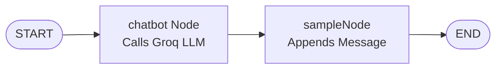
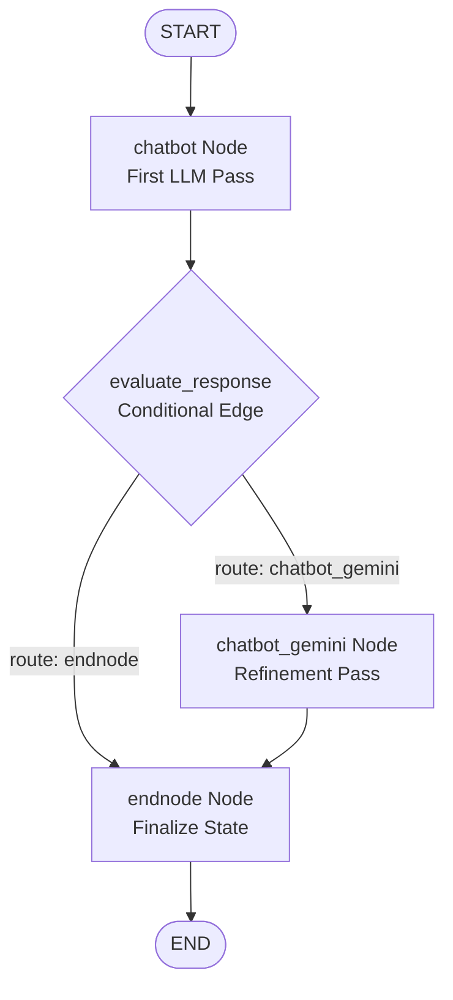

# 🦜🕸️ LangGraph Learning & Agentic Workflows

A hands-on guide and reference implementation for building stateful, multi-actor, and cyclical AI workflows using **LangGraph**, **LangChain**, and **Groq Cloud LLMs**.

---

## 🌟 Overview

[LangGraph](https://langchain-ai.github.io/langgraph/) is a framework for building robust, stateful, multi-agent LLM applications by modeling coordination as cyclical and acyclic graphs. 

This repository contains practical examples demonstrating foundational LangGraph patterns:
1. **Linear Pipelines with Message Reducers** (`chat.py`)
2. **Dynamic Conditional Branching & Routing** (`chat2.py`)

---

## 🏗️ Workflows

### 1. Linear Graph with Message History (`chat.py`)

Illustrates state preservation and message appending using LangGraph's `add_messages` reducer:



---

### 2. Conditional Branching (`chat2.py`)

Illustrates dynamic path decisions using `add_conditional_edges`:



---

## 🧠 Core LangGraph Concepts Covered

| Concept | Explanation | Code Example |
| :--- | :--- | :--- |
| **`State`** | A `TypedDict` representing the central state schema shared by all nodes. | `class State(TypedDict): ...` |
| **`add_messages`** | A reducer function that appends new messages to history instead of overwriting. | `messages: Annotated[list, add_messages]` |
| **Nodes** | Python functions that receive the current state and return state updates. | `def chatbot(state: State): ...` |
| **Linear Edges** | Fixed transitions connecting one node directly to the next. | `graph_builder.add_edge(START, "chatbot")` |
| **Conditional Edges** | Functions returning a string specifying the next node to execute. | `graph_builder.add_conditional_edges("chatbot", evaluate_response)` |

---

## 🛠️ Tech Stack

- **Framework:** [LangGraph](https://langchain-ai.github.io/langgraph/)
- **Orchestration:** [LangChain Core](https://python.langchain.com/) & [LangChain Groq](https://github.com/langchain-ai/langchain-groq)
- **LLM Inference:** [Groq](https://groq.com/) (Qwen 3.8 / Llama 3)
- **Language:** Python 3.10+

---

## 🚀 Getting Started

### 1. Prerequisites
- Python 3.10 or higher
- A free [Groq Cloud API Key](https://console.groq.com/keys)

---

### 2. Clone the Repository
```bash
git clone https://github.com/YOUR_USERNAME/LangGraph_learning.git
cd LangGraph_learning
```

---

### 3. Create and Activate Virtual Environment
```bash
# Windows (PowerShell)
python -m venv .venv
.\.venv\Scripts\activate

# macOS / Linux
python3 -m venv .venv
source .venv/bin/activate
```

---

### 4. Install Dependencies
```bash
pip install -r requirements.txt
```

---

### 5. Configure Environment Variables
Copy `.env.example` to `.env`:
```bash
cp .env.example .env
```

Add your Groq API key in `.env`:
```env
GROQ_API_KEY=gsk_your_actual_key_here
GROQ_MODEL=qwen/qwen3.8-27b
```

---

### 6. Run the Examples

#### Run Example 1 (Linear Message Graph):
```bash
python chat.py
```

#### Run Example 2 (Conditional Branching Graph):
```bash
python chat2.py
```

---

## 📜 License

MIT License. Feel free to use and adapt for your own AI agents.

